# Technical Documentation

> **myKotlinCleanExample**: an Android sample app that shows a two-column grid of sports. Tapping a sport opens a detail screen with a larger image and the sport's name.
> It is built with **Clean Architecture**, **MVVM**, **Jetpack Compose** and **Hilt**, and developed with **Spec-Driven Development (SDD)**.

This page is the in-depth technical reference. For the short version, see [`architecture.md`](architecture.md). For the binding rules, see [`constitution.md`](constitution.md). If this page and the constitution disagree, the constitution wins.

---

## Table of contents

1. [At a glance](#1-at-a-glance)
2. [Technology stack](#2-technology-stack)
3. [Clean Architecture](#3-clean-architecture)
4. [Domain layer](#4-domain-layer)
5. [Data layer](#5-data-layer)
6. [Presentation layer: MVVM](#6-presentation-layer-mvvm)
7. [Jetpack Compose UI](#7-jetpack-compose-ui)
8. [Navigation](#8-navigation)
9. [Dependency injection with Hilt](#9-dependency-injection-with-hilt)
10. [Coroutines, Flow and error handling](#10-coroutines-flow-and-error-handling)
11. [End-to-end data flow](#11-end-to-end-data-flow)
12. [Testing strategy](#12-testing-strategy)
13. [Static analysis and code style](#13-static-analysis-and-code-style)
14. [Build configuration](#14-build-configuration)
15. [Project layout](#15-project-layout)
16. [Spec-Driven Development workflow](#16-spec-driven-development-workflow)
17. [Recipe: adding a new feature](#17-recipe-adding-a-new-feature)

---

## 1. At a glance

| | |
|---|---|
| **Screens** | Sport list (2-column grid) → Sport detail |
| **Architecture** | Clean Architecture (`presentation → domain ← data`) + MVVM in presentation |
| **UI** | 100% Jetpack Compose, Material 3, dynamic color, edge-to-edge |
| **Activities** | One (`MainActivity`) hosting a Navigation Compose `NavHost` |
| **Data** | Local, in-memory catalog of 8 sports with bundled vector drawables (no network) |
| **DI** | Hilt |
| **Async** | Kotlin Coroutines + `StateFlow` |
| **Tests** | JUnit 5, MockK, Turbine, coroutines-test, Konsist (architecture rules), Compose UI tests |
| **Quality gates** | Android Lint, ktlint, detekt |

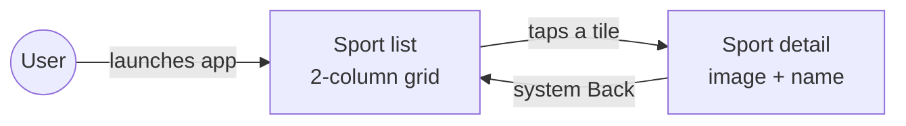

---

## 2. Technology stack

Versions come from [`gradle/libs.versions.toml`](../gradle/libs.versions.toml) and the Gradle wrapper. That file is the single source of truth; update this table when it changes.

| Concern | Library / tool | Version |
|---|---|---|
| Language | Kotlin (K2 compiler), JVM target 17 | 2.2.10 |
| Build | Android Gradle Plugin | 9.4.1 |
| Build | Gradle (Kotlin DSL + version catalog) | 9.6.0 |
| Annotation processing | KSP | 2.3.6 |
| SDK | `minSdk` / `targetSdk` / `compileSdk` | 24 / 35 / 35 |
| UI | Compose BOM (UI, Material 3, tooling) | 2024.12.01 |
| UI host | `activity-compose` | 1.9.3 |
| Lifecycle | `lifecycle-runtime-compose`, `lifecycle-viewmodel-compose` | 2.8.7 |
| Navigation | Navigation Compose (type-safe routes) | 2.8.5 |
| Serialization | `kotlinx-serialization-json` (for nav routes) | 1.7.3 |
| DI | Hilt / `hilt-navigation-compose` | 2.53.1 / 1.2.0 |
| Async | `kotlinx-coroutines-core` | 1.9.0 |
| Unit tests | JUnit 5 (Jupiter) via `android-junit5` plugin | 5.11.4 |
| Mocking | MockK | 1.13.13 |
| Flow testing | Turbine | 1.2.0 |
| Coroutine testing | `kotlinx-coroutines-test` | 1.9.0 |
| Architecture tests | Konsist | 0.17.3 |
| UI tests | Compose `ui-test-junit4`, Espresso, AndroidX Test Runner | BOM / 3.7.0 / 1.7.0 |
| Lint | Android Lint, ktlint (Gradle plugin), detekt | — / 12.1.2 / 1.23.7 |

**Required JDK:** 17 or 21, e.g. `export JAVA_HOME=$(/usr/libexec/java_home -v 21)`.

Adding a library requires a line in the relevant `plan.md` explaining why (constitution, Article III).

---

## 3. Clean Architecture

The app has three layers. Dependencies point **inward** to `domain`, which knows nothing about Android, the UI or where data comes from.

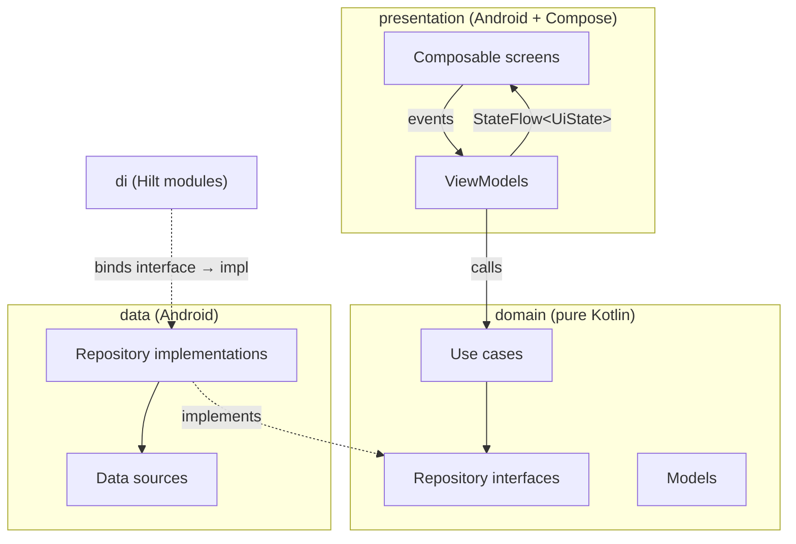

### The dependency rule

```
presentation ──▶ domain ◀── data
```

| Layer | May depend on | Must **not** depend on |
|---|---|---|
| `domain` | Kotlin stdlib, `javax.inject` | `android.*`, `androidx.*`, `R`, `data`, `presentation` |
| `data` | `domain`, Android resources | `presentation` |
| `presentation` | `domain`, Android, Compose | `data` |
| `di` | everything (it is the composition root) | — |

These rules are **enforced by tests**, not only by convention. [`LayerRulesTest`](../app/src/test/java/alvaro/exposito/mykotlincleanexample/architecture/LayerRulesTest.kt) uses Konsist to scan every production file and fails the build if, for example, a domain file imports `androidx.*`.

### Why this shape

- **Testability.** Use cases and ViewModels run on the plain JVM with fakes; no emulator needed.
- **Replaceable data.** Swapping the in-memory catalog for Room or a REST API touches only `data` and `di`. The domain contract (`SportRepository`) stays the same.
- **Clear ownership.** UI logic lives in ViewModels, business rules in use cases, I/O in data sources.

---

## 4. Domain layer

Package: `alvaro.exposito.mykotlincleanexample.domain`. Pure Kotlin.

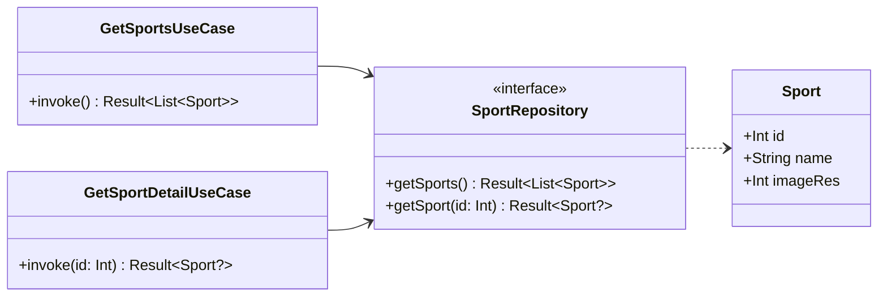

### Model

```kotlin
data class Sport(
    val id: Int,
    val name: String,
    val imageRes: Int, // drawable id kept as Int so domain has no Android imports
)
```

`imageRes` is a deliberate trade-off: it is an Android resource id, but typed as a plain `Int` so the domain module compiles without the Android SDK.

### Repository contract

```kotlin
interface SportRepository {
    /** All sports, each exactly once, ordered by id. */
    suspend fun getSports(): Result<List<Sport>>

    /** The sport with [id], or `null` when no sport has that id. */
    suspend fun getSport(id: Int): Result<Sport?>
}
```

Two important choices:

- **`Result<T>` instead of exceptions.** Failures never cross a layer boundary as thrown exceptions.
- **`null` means "not found", failure means "something broke".** The detail screen uses this to tell "No info" apart from an error.

### Use cases

One use case per user action, named `VerbNounUseCase`, with a single `operator fun invoke` so it can be called like a function:

```kotlin
class GetSportsUseCase @Inject constructor(
    private val repository: SportRepository,
) {
    suspend operator fun invoke(): Result<List<Sport>> = repository.getSports()
}

// In a ViewModel:
getSports().fold(onSuccess = { … }, onFailure = { … })
```

Today the use cases simply delegate. They exist so that business rules (filtering, sorting, combining repositories) have an obvious home later, and so ViewModels never talk to repositories directly.

---

## 5. Data layer

Package: `alvaro.exposito.mykotlincleanexample.data`.

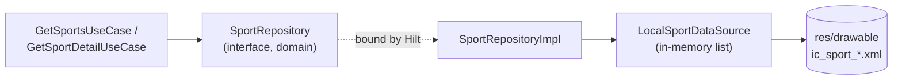

### `LocalSportDataSource`

An in-memory, immutable catalog of 8 sports. Each one points to a bundled vector drawable, so the app works fully offline.

| id | Name | Drawable |
|---|---|---|
| 1 | Baseball | `ic_sport_baseball` |
| 2 | Windsurfing | `ic_sport_windsurfing` |
| 3 | Cycling | `ic_sport_cycling` |
| 5 | Motorcycle | `ic_sport_motorcycle` |
| 6 | Football | `ic_sport_football` |
| 7 | Swimming | `ic_sport_swimming` |
| 8 | Karate | `ic_sport_karate` |
| 9 | Athletics | `ic_sport_athletics` |

Id 4 is intentionally missing: it preserves the ids of the legacy app (see [`specs/000-baseline`](../specs/000-baseline/spec.md)).

### `SportRepositoryImpl`

Wraps every data-source call in `runCatching`, so any exception becomes a `Result.failure`:

```kotlin
override suspend fun getSports(): Result<List<Sport>> =
    runCatching { dataSource.getSports() }

override suspend fun getSport(id: Int): Result<Sport?> =
    runCatching { dataSource.getSports().firstOrNull { it.id == id } }
```

---

## 6. Presentation layer: MVVM

Package: `alvaro.exposito.mykotlincleanexample.presentation`.

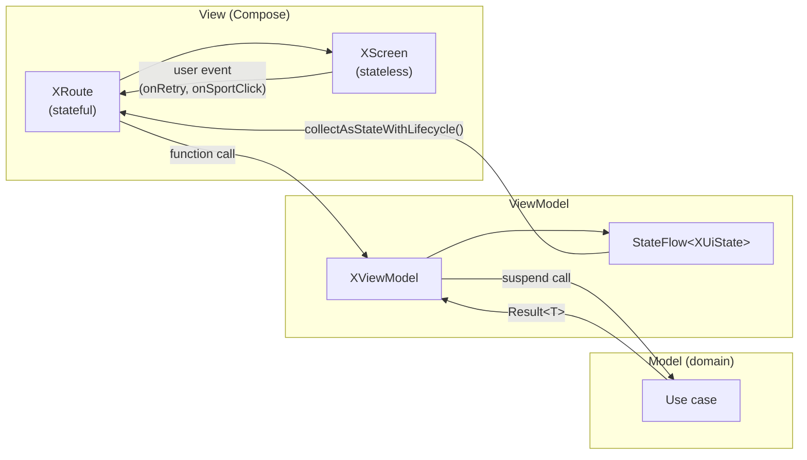

### Rules

1. A ViewModel exposes **one** immutable `val uiState: StateFlow<XUiState>`. The mutable `MutableStateFlow` stays private.
2. UI events go **in** as plain function calls (`retry()`). State comes **out** through the flow. This is unidirectional data flow (UDF).
3. ViewModels never hold a `Context`, `View` or Compose type.
4. `UiState` is a `sealed interface`, so the `when` in the screen is exhaustive and the compiler catches missing states.

### UI state machines

**Sport list** ([`SportListUiState`](../app/src/main/java/alvaro/exposito/mykotlincleanexample/presentation/sportlist/SportListUiState.kt)):

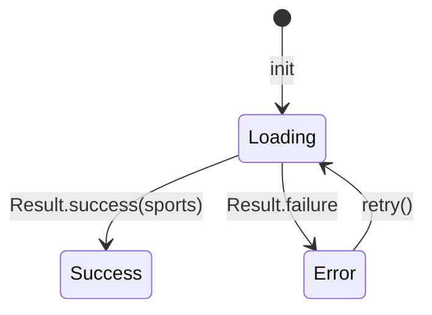

**Sport detail** ([`SportDetailUiState`](../app/src/main/java/alvaro/exposito/mykotlincleanexample/presentation/sportdetail/SportDetailUiState.kt)):

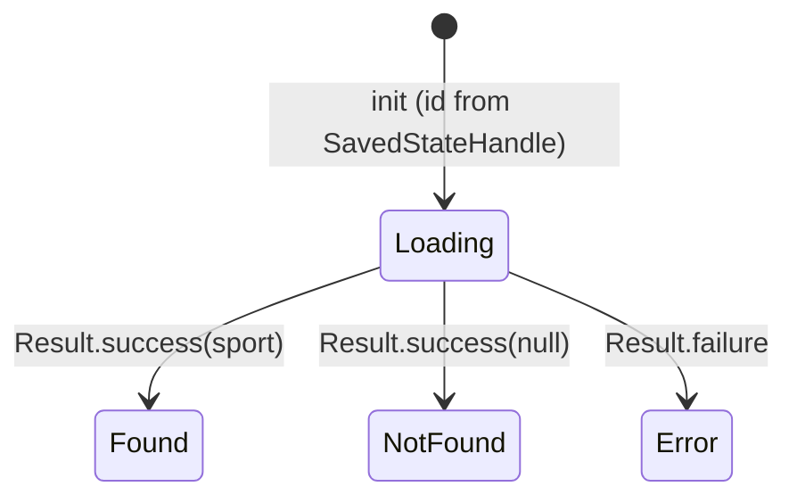

### ViewModel example

```kotlin
@HiltViewModel
class SportListViewModel @Inject constructor(
    private val getSports: GetSportsUseCase,
) : ViewModel() {
    private val _uiState = MutableStateFlow<SportListUiState>(SportListUiState.Loading)
    val uiState: StateFlow<SportListUiState> = _uiState.asStateFlow()

    init { load() }

    fun retry() = load()

    private fun load() {
        _uiState.value = SportListUiState.Loading
        viewModelScope.launch {
            _uiState.value = getSports().fold(
                onSuccess = { SportListUiState.Success(it) },
                onFailure = { SportListUiState.Error(it.message) },
            )
        }
    }
}
```

`SportDetailViewModel` reads the sport id from `SavedStateHandle` (key `ARG_ID = "id"`), which Navigation Compose fills from the type-safe route. This means the id survives process death and the ViewModel doesn't need any navigation types.

---

## 7. Jetpack Compose UI

### Route / Screen split (state hoisting)

Every screen has two composables:

| Composable | Knows about | Purpose |
|---|---|---|
| `SportListRoute` | ViewModel, Hilt | Gets the ViewModel with `hiltViewModel()`, collects state, wires callbacks |
| `SportListScreen` | Only `UiState` + lambdas | Pure rendering; easy to preview and UI-test with any state |

```kotlin
@Composable
fun SportListRoute(
    onSportClick: (Int) -> Unit,
    viewModel: SportListViewModel = hiltViewModel(),
) {
    val state by viewModel.uiState.collectAsStateWithLifecycle()
    SportListScreen(state = state, onRetry = viewModel::retry, onSportClick = onSportClick)
}
```

`collectAsStateWithLifecycle()` stops collecting when the screen goes to the background, so no work is wasted while the app isn't visible.

### Composition tree

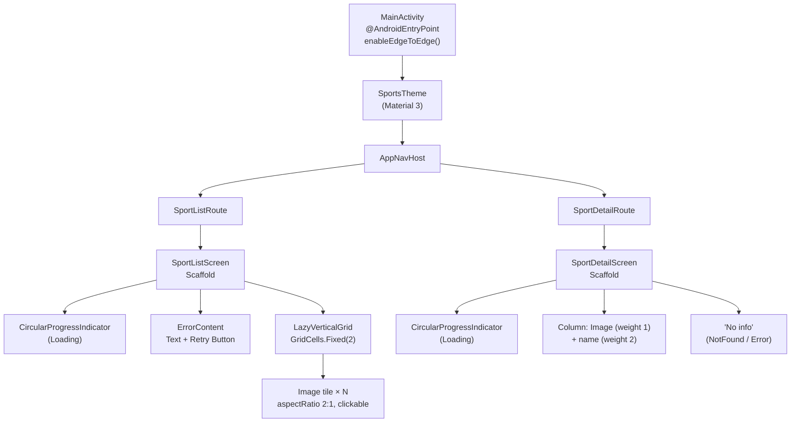

### Screen details

**Sport list**
- `LazyVerticalGrid` with `GridCells.Fixed(2)` and 1 dp spacing.
- Items use `key = { it.id }`, so Compose keeps item identity stable across recompositions.
- `rememberLazyGridState()` lives inside the navigation back-stack entry, so returning from the detail screen restores the scroll position (AC-8).
- Each tile is an `Image` with `ContentScale.Crop`, `aspectRatio(2f)` and `contentDescription = sport.name` for accessibility (and for UI tests).

**Sport detail**
- Image fills the top third (`weight(1f)`), name centered in the bottom two thirds (`weight(2f)`), using `MaterialTheme.typography.displayMedium`.
- `NotFound` and `Error` both show the "No info" string.

### Theme

[`SportsTheme`](../app/src/main/java/alvaro/exposito/mykotlincleanexample/presentation/theme/Theme.kt) picks a color scheme:

| Condition | Color scheme |
|---|---|
| Android 12+ (API 31+) | Dynamic color from the wallpaper (`dynamicLight/DarkColorScheme`) |
| Older, dark mode | `darkColorScheme()` |
| Older, light mode | `lightColorScheme()` |

`MainActivity` calls `enableEdgeToEdge()`, and each `Scaffold` passes its inner padding to the content so nothing is drawn under the system bars.

### Strings and test tags

- All user-visible text is in [`res/values/strings.xml`](../app/src/main/res/values/strings.xml) (`sport_list_error`, `retry`, `sport_detail_no_info`, …).
- [`SportListTestTags`](../app/src/main/java/alvaro/exposito/mykotlincleanexample/presentation/sportlist/SportListTestTags.kt) holds the `Modifier.testTag` ids (`sport_grid`, `sport_tile`, `sport_list_loading`) shared by production code and UI tests.

---

## 8. Navigation

Navigation Compose with **type-safe routes**: destinations are `@Serializable` Kotlin types, not strings.

```kotlin
@Serializable data object SportListDestination
@Serializable data class SportDetailDestination(val id: Int)

NavHost(navController, startDestination = SportListDestination) {
    composable<SportListDestination> {
        SportListRoute(onSportClick = { id -> navController.navigate(SportDetailDestination(id)) })
    }
    composable<SportDetailDestination> { SportDetailRoute() }
}
```

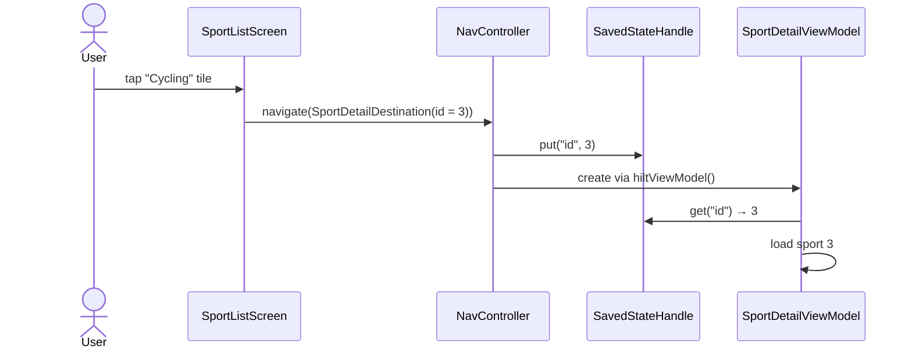

Conventions:

- **Pass ids only**, never whole objects. Each screen loads its own data through its ViewModel.
- The route property name (`id`) must match `SportDetailViewModel.ARG_ID`. Both have a comment pointing to each other.
- Screens receive navigation as lambdas (`onSportClick`), so they never see the `NavController`.

---

## 9. Dependency injection with Hilt

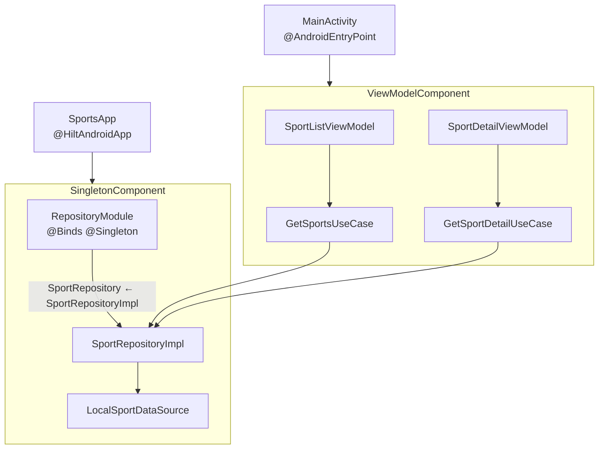

| Piece | Annotation | Role |
|---|---|---|
| `SportsApp` | `@HiltAndroidApp` | Creates the app-level component |
| `MainActivity` | `@AndroidEntryPoint` | Lets composables inside it obtain Hilt ViewModels |
| `SportListViewModel`, `SportDetailViewModel` | `@HiltViewModel` + `@Inject constructor` | Created by `hiltViewModel()` in each `Route` |
| Use cases, repository impl, data source | `@Inject constructor` | Constructor injection, no modules needed |
| `RepositoryModule` | `@Module @InstallIn(SingletonComponent)` | `@Binds` the domain interface to the data implementation |

`di/` is the only package that knows both `domain` and `data`. It is the composition root.

Hilt's code is generated at compile time with **KSP** (not kapt).

For instrumented tests, [`HiltTestRunner`](../app/src/androidTest/java/alvaro/exposito/mykotlincleanexample/HiltTestRunner.kt) swaps the application for `HiltTestApplication`.

---

## 10. Coroutines, Flow and error handling

| Concern | How it is done |
|---|---|
| Scope | `viewModelScope`, cancelled automatically when the ViewModel is cleared |
| Repository/use-case API | `suspend` functions returning `Result<T>` |
| State | `MutableStateFlow` (private) → `StateFlow` (public) via `asStateFlow()` |
| UI collection | `collectAsStateWithLifecycle()` |
| Threading | Data is in memory, so no dispatcher switch is needed today. A real I/O source should switch with `withContext(Dispatchers.IO)` **inside the data layer** |

### Error flow

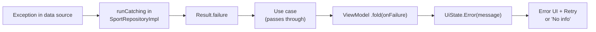

Exceptions never escape the data layer. Every failure ends up as an explicit UI state.

---

## 11. End-to-end data flow

What happens when the app starts:

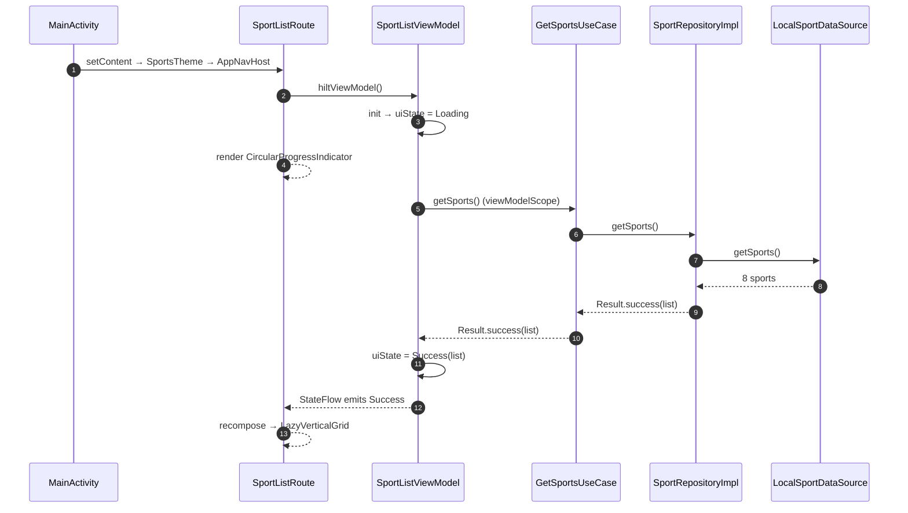

---

## 12. Testing strategy

Tests are written **from the spec, before the code** (constitution, Article IV). Every acceptance criterion `AC-x` in [`specs/001-modernize-stack/spec.md`](../specs/001-modernize-stack/spec.md) has at least one test whose name references it.

### Test pyramid

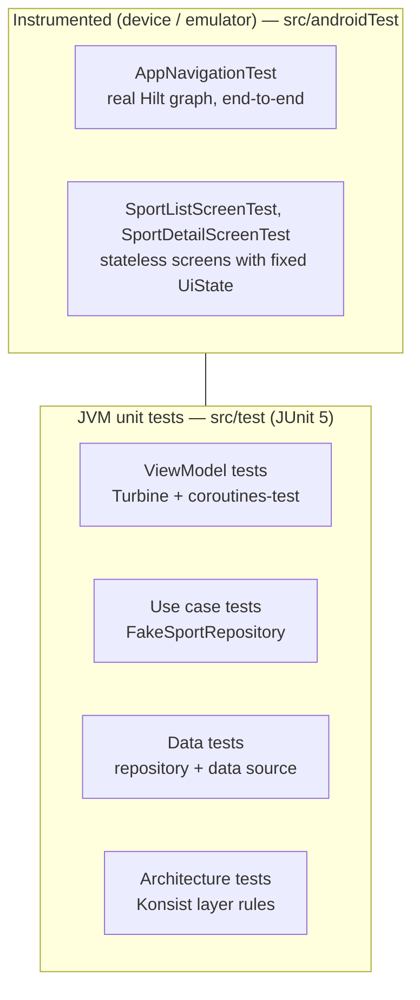

### Tools

| Tool | Used for |
|---|---|
| **JUnit 5** | All JVM tests (via the `de.mannodermaus.android-junit5` plugin) |
| **`FakeSportRepository`** | Hand-written fake with a settable `failure`, used by use-case and ViewModel tests |
| **MockK** | Mocking when a fake isn't practical |
| **Turbine** | Asserting the exact sequence of `StateFlow` emissions (`Loading` → `Success`) |
| **`kotlinx-coroutines-test`** | `runTest` and `StandardTestDispatcher` |
| **`MainDispatcherExtension`** | JUnit 5 extension that replaces `Dispatchers.Main` so `viewModelScope` works on the JVM |
| **Konsist** | Fails the build if a file breaks the layer rules |
| **Compose UI test** | `createComposeRule` / `createAndroidComposeRule`, finding nodes by text, content description and test tag |
| **Hilt testing** | `@HiltAndroidTest` + `HiltAndroidRule` for the end-to-end navigation tests |

### ViewModel test example

```kotlin
@Test
fun `AC-3 shows Error when the repository fails, and retry reloads the list`() = runTest {
    repository.failure = IllegalStateException("boom")
    val viewModel = viewModel()

    viewModel.uiState.test {
        assertEquals(SportListUiState.Loading, awaitItem())
        assertTrue(awaitItem() is SportListUiState.Error)

        repository.failure = null
        viewModel.retry()

        assertEquals(SportListUiState.Loading, awaitItem())
        assertEquals(SportListUiState.Success(sports), awaitItem())
    }
}
```

### Traceability: acceptance criteria → tests

| AC | Behavior | Tests |
|---|---|---|
| AC-1 | 2-column grid, 8 sports, ordered, no duplicates | `LocalSportDataSourceTest`, `SportRepositoryImplTest`, `GetSportsUseCaseTest`, `SportListViewModelTest`, `SportListScreenTest.ac1_…` |
| AC-2 | Loading indicator while loading | `SportListViewModelTest`, `SportListScreenTest.ac2_…` |
| AC-3 | Error + Retry | `SportRepositoryImplTest`, `GetSportsUseCaseTest`, `SportListViewModelTest`, `SportListScreenTest.ac3_…` |
| AC-4 | Images are bundled drawables | `LocalSportDataSourceTest` |
| AC-5 | Tapping a tile opens its detail | `SportListScreenTest.ac5_…`, `AppNavigationTest.ac5_…` |
| AC-6 | Detail shows image above name | `SportRepositoryImplTest`, `GetSportDetailUseCaseTest`, `SportDetailViewModelTest`, `SportDetailScreenTest.ac6_…` |
| AC-7 | Unknown id shows "No info" | `SportRepositoryImplTest`, `GetSportDetailUseCaseTest`, `SportDetailViewModelTest`, `SportDetailScreenTest.ac7_…` |
| AC-8 | Back restores list scroll position | `AppNavigationTest.ac8_…` |
| AC-9 | Full build and checks pass on JDK 17 | CI / `./gradlew` command below |
| AC-10 | Layer and package rules | `LayerRulesTest` |

Instrumented tests need a device or emulator. Espresso 3.7+ is required for Android 16+ images.

---

## 13. Static analysis and code style

| Tool | Config | What it checks |
|---|---|---|
| Android Lint | AGP defaults | Android API misuse, resources, accessibility |
| ktlint | [`.editorconfig`](../.editorconfig) | ktlint official style, no wildcard imports |
| detekt | [`config/detekt/detekt.yml`](../config/detekt/detekt.yml) (on top of the default config) | Complexity, naming, potential bugs |

Style rules from the constitution (Article VI): English everywhere, immutable data by default, KDoc on public domain APIs, comments explain *why*.

A task is done only when this is green:

```bash
./gradlew lint ktlintCheck detekt testDebugUnitTest
```

---

## 14. Build configuration

- **Single module** `:app`. The constitution says to split into Gradle modules only when a spec justifies it.
- **Version catalog** in `gradle/libs.versions.toml`; plugins declared with `alias(libs.plugins.…)` in the root `build.gradle.kts` with `apply false`.
- **Compose** enabled with `buildFeatures.compose = true` and the Kotlin Compose compiler plugin (`org.jetbrains.kotlin.plugin.compose`).
- **Kotlin serialization plugin** powers the type-safe navigation routes.
- **Java/Kotlin target** 17.
- **Release** build has minification off for now (`isMinifyEnabled = false`).
- `testOptions.unitTests.isReturnDefaultValues = true` so JVM tests don't crash on stubbed Android calls.
- Custom instrumentation runner: `alvaro.exposito.mykotlincleanexample.HiltTestRunner`.

### Commands

```bash
./gradlew assembleDebug                    # build the debug APK
./gradlew installDebug                     # install on a connected device
./gradlew testDebugUnitTest                # JVM unit + architecture tests
./gradlew connectedDebugAndroidTest        # Compose UI / instrumented tests (device needed)
./gradlew lint ktlintCheck detekt          # static analysis
./gradlew ktlintFormat                     # auto-fix formatting
```

---

## 15. Project layout

```
myKotlinCleanExample/
├── AGENTS.md / CLAUDE.md          # instructions for AI coding agents
├── README.md
├── docs/
│   ├── constitution.md            # binding project rules
│   ├── sdd-workflow.md            # spec → plan → tasks → implement
│   ├── architecture.md            # short architecture summary
│   └── TECHNICAL.md               # this page
├── specs/
│   ├── _templates/                # spec / plan / tasks templates
│   ├── 000-baseline/              # behavior of the legacy app
│   └── 001-modernize-stack/       # spec, plan, tasks for the current stack
├── config/detekt/detekt.yml
├── gradle/libs.versions.toml
└── app/src/
    ├── main/java/alvaro/exposito/mykotlincleanexample/
    │   ├── MainActivity.kt        # single Activity, edge-to-edge, hosts NavHost
    │   ├── SportsApp.kt           # @HiltAndroidApp
    │   ├── di/RepositoryModule.kt
    │   ├── domain/
    │   │   ├── model/Sport.kt
    │   │   ├── repository/SportRepository.kt
    │   │   └── usecase/GetSportsUseCase.kt, GetSportDetailUseCase.kt
    │   ├── data/
    │   │   ├── local/LocalSportDataSource.kt
    │   │   └── repository/SportRepositoryImpl.kt
    │   └── presentation/
    │       ├── navigation/AppNavHost.kt
    │       ├── theme/Theme.kt
    │       ├── sportlist/         # Route + Screen, ViewModel, UiState, TestTags
    │       └── sportdetail/       # Route + Screen, ViewModel, UiState
    ├── test/…                     # mirrors main: architecture, data, domain, presentation, testutil
    └── androidTest/…              # HiltTestRunner, navigation and screen UI tests
```

---

## 16. Spec-Driven Development workflow

Code is an implementation of an approved spec. Every non-trivial change goes through four phases, each ending with a **human** approval.

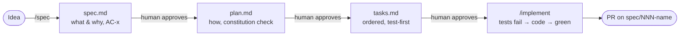

- Before editing anything in `app/src/main`, the active spec's `spec.md` **and** `plan.md` must say `Status: Approved`.
- Branch per spec (`spec/NNN-short-name`), Conventional Commits that reference it (`feat(001): …`).
- Trivial changes (typos, docs, formatting, patch bumps) skip the spec and use `chore:` / `docs:`.

Full details: [`sdd-workflow.md`](sdd-workflow.md).

---

## 17. Recipe: adding a new feature

Example: a "favorite sports" feature. After its spec and plan are approved:

1. **Domain**
   - Add or extend models in `domain/model`.
   - Add methods to a repository interface (or a new interface) in `domain/repository`, returning `Result<T>` or `Flow<T>`.
   - Add one `VerbNounUseCase` per user action (`ToggleFavoriteUseCase`, `GetFavoritesUseCase`), with tests against a fake repository.
2. **Data**
   - Implement the interface in `data/repository`, hiding the data source behind it. Wrap I/O in `runCatching` and switch to `Dispatchers.IO` if it blocks.
   - Bind it in `di/` with `@Binds`.
3. **Presentation**
   - Create `presentation/<feature>/` with a sealed `XUiState`, a `@HiltViewModel` exposing `StateFlow<XUiState>`, a stateful `XRoute` and a stateless `XScreen`.
   - Add a `@Serializable` destination and a `composable<…>` entry in `AppNavHost`. Pass ids only.
4. **Tests**: write them first, named after the AC ids, at each layer. `LayerRulesTest` will catch any import that breaks the dependency rule.
5. **Check**: `./gradlew lint ktlintCheck detekt testDebugUnitTest` and, with a device, `connectedDebugAndroidTest`.
